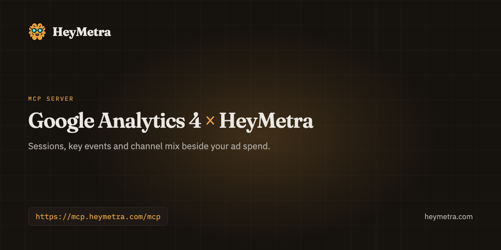

<div align="center">



# Google Analytics 4 &times; HeyMetra

**Sessions, key events and channel mix beside your ad spend.**

Google Analytics 4 knows what people did. It does not know what it cost, or what it earned. Connect it beside the accounts that do.

[](https://registry.modelcontextprotocol.io/v0/servers/com.heymetra%2Fheymetra/versions)
[](https://modelcontextprotocol.io/)
[](https://heymetra.com/security/)
[](https://heymetra.com/connectors/google-analytics-4/)

```
https://mcp.heymetra.com/mcp
```

</div>

---

## Ask it things like

> Which channels brought the most key events this month?

> Which campaign brought the most engaged sessions last month?

> Which events fired most often this week?

> Which landing pages bring sessions that actually engage?

> How many sessions and users did the site get in the last 30 days?

> What can I break this property's traffic down by?

No dashboard, no export, no query language. You ask in the assistant you already use and the answer comes back with the account it came from.

## Connect Google Analytics 4

**1. Sign in with a Google account that can read the property**

Choose Google Analytics 4 on the Connections screen. Google's own sign-in follows and your password never reaches HeyMetra.

> Viewer is enough. Nothing here needs edit or administrator access, and HeyMetra asks Google for read-only access.

**2. Pick the PROPERTY, not the account**

A Google Analytics account holds properties, and a property is what has data in it. One HeyMetra connection is one property.

> A Universal Analytics property is not a GA4 one. UA stopped collecting in 2023 and its API is gone; if the property list looks wrong, check you are not looking at the old one.

**3. Add HeyMetra to the assistant you use**

Claude, ChatGPT, Grok, Perplexity, Claude Code, Codex, Cursor or Antigravity. The traffic and channel tools appear there and read the property when asked.

The same steps are on the docs page: [Google Analytics 4 setup guide](https://heymetra.com/docs/google-analytics-4/).

## Then add HeyMetra to your assistant

Add HeyMetra once and it is there in every conversation. The address is the same everywhere:

```
https://mcp.heymetra.com/mcp
```

### One command

```bash
npx add-mcp https://mcp.heymetra.com/mcp
```

[`add-mcp`](https://www.npmjs.com/package/add-mcp) is a third-party installer that writes the configuration for Claude Code, Codex, Cursor, Antigravity, VS Code and seventeen other agents. It infers the name from the address, so the server lands as `heymetra`. Run against this endpoint before it was written here.

### Or by hand

<details>
<summary><b>Claude</b> — Settings → Customize → Connectors → Add custom connector</summary>

Paste the address above into Settings → Customize → Connectors → Add custom connector.

_On Team and Enterprise plans, an owner adds the connector for the whole organization under Organization settings → Connectors, and each member then connects to it._

Full walkthrough: [heymetra.com/mcp/claude/](https://heymetra.com/mcp/claude/)
</details>

<details>
<summary><b>ChatGPT</b> — chatgpt.com/plugins → + → Add custom MCP server</summary>

Paste the address above into chatgpt.com/plugins → + → Add custom MCP server.

_Add it on chatgpt.com in a browser, because the mobile app cannot add one. Every ChatGPT plan can, Free included. In a Business, Enterprise or Edu workspace, an admin or owner decides whether members can add custom MCP servers. ChatGPT needs the full address, including /mcp at the end._

Full walkthrough: [heymetra.com/mcp/chatgpt/](https://heymetra.com/mcp/chatgpt/)
</details>

<details>
<summary><b>Grok</b> — grok.com/connectors → New Connector → Custom</summary>

Paste the address above into grok.com/connectors → New Connector → Custom.

_On Grok Business and Enterprise, a team admin has to provision the connector in xAI's cloud console before members can use it._

Full walkthrough: [heymetra.com/mcp/grok/](https://heymetra.com/mcp/grok/)
</details>

<details>
<summary><b>Perplexity</b> — Plugins → Add custom → Connector → Add MCP connector → Remote</summary>

Paste the address above into Plugins → Add custom → Connector → Add MCP connector → Remote.

_In an organization, members can add a custom connector only after an admin turns on Allow members to add custom connectors, which is off by default._

Full walkthrough: [heymetra.com/mcp/perplexity/](https://heymetra.com/mcp/perplexity/)
</details>

<details>
<summary><b>Claude Code</b> — claude mcp add --transport http</summary>

```bash
claude mcp add --transport http heymetra https://mcp.heymetra.com/mcp
```

_You can also add the server to a .mcp.json file at the project root. Run /mcp in a session to sign in and to check that it connected._

Full walkthrough: [heymetra.com/mcp/claude-code/](https://heymetra.com/mcp/claude-code/)
</details>

<details>
<summary><b>Codex</b> — ~/.codex/config.toml</summary>

```toml
[mcp_servers.heymetra]
url = "https://mcp.heymetra.com/mcp"
```

_Codex reads the server from an [mcp_servers.<name>] section in config.toml, and you sign in with codex mcp login <name>._

Full walkthrough: [heymetra.com/mcp/codex/](https://heymetra.com/mcp/codex/)
</details>

<details>
<summary><b>Cursor</b> — ~/.cursor/mcp.json, or .cursor/mcp.json in a project</summary>

```json
{
  "mcpServers": {
    "heymetra": { "url": "https://mcp.heymetra.com/mcp" }
  }
}
```

_Cursor signs in to HeyMetra without a client ID or secret, so the server entry needs no auth block._

Full walkthrough: [heymetra.com/mcp/cursor/](https://heymetra.com/mcp/cursor/)
</details>

<details>
<summary><b>Antigravity</b> — ~/.gemini/config/mcp_config.json, or .agents/mcp_config.json in a project</summary>

```json
{
  "mcpServers": {
    "heymetra": { "serverUrl": "https://mcp.heymetra.com/mcp" }
  }
}
```

_Antigravity's documented key for the address is serverUrl, though it also accepts url._

Full walkthrough: [heymetra.com/mcp/antigravity/](https://heymetra.com/mcp/antigravity/)
</details>

## What it may and may not touch

Google Analytics 4 is a read-only source. HeyMetra reads it to answer your questions and never changes anything in it.

Permissions are switched on per connection, and one you leave off is a tool your assistant never sees.

| Permission | What it covers | Changes anything? |
|---|---|---|
| **Included with the connection** | What HeyMetra needs to set the connection up, and nothing more. It cannot be switched off on its own; to withdraw it, remove the connection. | No, read only |
| **Full account access** | Lets your assistant read anything in this account to answer your questions. The figures are the provider's own, not ones HeyMetra has checked. It cannot change anything in this account. | No, read only |

<details>
<summary>What each permission lets an assistant do, in full</summary>

- Ask anything about this account and get the answer from its live data. Reads only, and the figures are the provider's own rather than ones HeyMetra has checked.
</details>

## When something goes wrong

<details>
<summary>Today's numbers are lower than the GA4 dashboard shows.</summary>

**Why:** GA4 processes data with a lag, and the most recent day is still filling in. The dashboard's realtime card is a different measurement from the reports this reads.

**Fix:** Compare a closed day. HeyMetra says when a period is still moving rather than leaving it to be noticed.

</details>

<details>
<summary>A dimension the team uses is not accepted.</summary>

**Why:** Custom dimensions are per property, and each has a technical name that is rarely the label shown in the interface.

**Fix:** Ask your assistant which dimensions the property has, and use the name it reports.

</details>

<details>
<summary>Figures are far below what the site's own logs show.</summary>

**Why:** GA4 counts what its tag reports, and a consent banner, an ad blocker or a missing tag on part of the site all remove traffic before it is counted.

**Fix:** Nothing to fix in the connection. Treat GA4 as a measure of measured traffic rather than of all traffic, and compare with Search Console for the search side of it.

</details>

## What HeyMetra reads from Google Analytics 4

Connect the property once and ask about it from your assistant: sessions, users, engaged sessions and key events for any period, day by day; which channels, campaigns and landing pages brought them; which events fired most often; and any dimension or metric the property itself carries, custom ones included. Every answer names the property and the period it covers, says when the last days are still filling in, and reports key events under that name rather than as conversions. HeyMetra only reads: it never changes a property, an event or a setting.

<details>
<summary>About Google Analytics 4</summary>

Google Analytics 4 (GA4) is Google’s analytics platform for understanding how people find and use your website or app. It’s the source of truth for traffic, conversions, and channel performance.
</details>

## One connection, not seven

The reason to read Google Analytics 4 through HeyMetra rather than through a server that only knows Google Analytics 4 is everything else it can answer in the same breath:

**Ads** — [Google Ads](https://github.com/zeisoft/google-ads-mcp) · [Meta](https://github.com/zeisoft/meta-ads-mcp)

**Analytics** — **Google Analytics 4** · [Google Search Console](https://github.com/zeisoft/google-search-console-mcp) · [PostHog](https://github.com/zeisoft/posthog-mcp)

**Ecommerce** — [Trendyol](https://github.com/zeisoft/trendyol-mcp) · [n11](https://github.com/zeisoft/n11-mcp) · [Çiçeksepeti](https://github.com/zeisoft/ciceksepeti-mcp) · [Amazon Seller Central](https://github.com/zeisoft/amazon-seller-central-mcp) · [ikas](https://github.com/zeisoft/ikas-mcp) · [WooCommerce](https://github.com/zeisoft/woocommerce-mcp)

**Revenue & CRM** — [Stripe](https://github.com/zeisoft/stripe-mcp) · [Zoho CRM](https://github.com/zeisoft/zoho-crm-mcp) · [Zoho SalesIQ](https://github.com/zeisoft/zoho-salesiq-mcp) · [Zoho Marketing Automation](https://github.com/zeisoft/zoho-marketing-automation-mcp)

**Mobile** — [AppsFlyer](https://github.com/zeisoft/appsflyer-mcp) · [RevenueCat](https://github.com/zeisoft/revenuecat-mcp) · [Adapty](https://github.com/zeisoft/adapty-mcp) · [App Store Connect](https://github.com/zeisoft/app-store-connect-mcp)

**Work** — [Jira](https://github.com/zeisoft/jira-mcp)

**Channels** — [Slack](https://github.com/zeisoft/slack-mcp) · [Telegram](https://github.com/zeisoft/telegram-mcp)

The full catalogue is at [heymetra.com/connectors/](https://heymetra.com/connectors/).

## Links

- [Google Analytics 4 connector page](https://heymetra.com/connectors/google-analytics-4/)
- [Google Analytics 4 setup guide](https://heymetra.com/docs/google-analytics-4/)
- [HeyMetra](https://heymetra.com/) — what the product is
- [Setup for every assistant](https://heymetra.com/mcp/)
- [Security and limits](https://heymetra.com/security/)
- [Pricing](https://heymetra.com/pricing/)
- [HeyMetra's own repository](https://github.com/zeisoft/heymetra-mcp)

---

<sub>Built by <a href="https://zeisoft.com">Zeisoft</a>, who make HeyMetra. Not affiliated with Google Analytics 4. This README is generated from HeyMetra's live connector catalogue and refreshed daily; corrections are welcome as issues.</sub>
